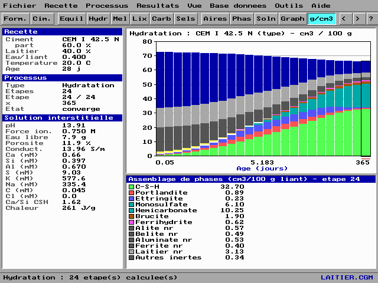
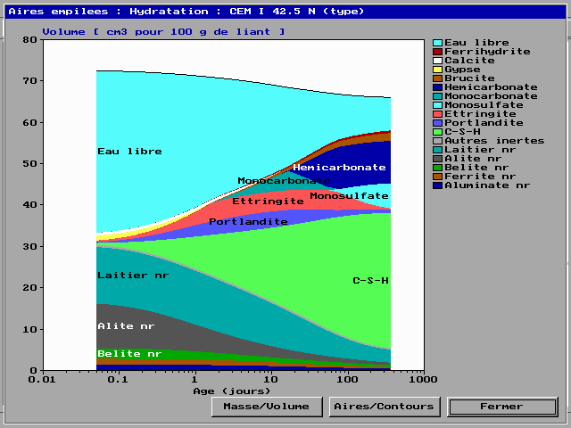

# CIMENT-0
Suite de commande écrit en Turbo Pascal/Free Pascal pour le ciment et le béton.

Aperçu de VCCTL :


Aperçu de CEMGEMS :



Aires empilées des phases en fonction du temps (échelle logarithmique) :



<h2>Liste des fichiers</h3>

Voici la liste des différents fichiers proposés dans CIMENT-0 :

<table>
  <tr>
    <th>Nom</th>
    <th>Description</th>
  </tr>
  <tr>
    <td><b>BETON.PAS</b></td>
    <td>Cette commande permet de calculer le béton (volume, dosage, masse, rapport eau/ciment, résistance à la compression, formulation).</b>
  </tr>
  <tr>
	  <td><b>CEMGEMS.PAS</b></td>
	  <td>Cette commande permet de modéliser, à la manière du logiciel CemGEMS (cemgems.org), l'équilibre thermodynamique d'un matériau cimentaire (minimisation de l'énergie libre de Gibbs, base inspirée de Cemdata18) : hydratation (cinétique de Parrot-Killoh), mélange (balayage de recette), lixiviation, carbonatation et pénétration de sels. Elle fournit l'assemblage de phases (g et cm³ pour 100 g de liant, aires empilées en fonction du temps), la composition de la solution interstitielle (pH, force ionique, concentrations, conductivité), la porosité et la chaleur d'hydratation.</td>
  </tr>
  <tr>
	  <td><b>VCCTL.PAS</b></td>
	  <td>Cette commande permet de simuler, à la manière du logiciel VCCTL (Virtual Cement and Concrete Testing Laboratory), la microstructure 3D et l'hydratation d'une pâte de ciment (ciment Portland, cendres volantes, laitier, calcaire, fumée de silice) par automate cellulaire, puis d'estimer ses propriétés : degré d'hydratation, chaleur dégagée, retrait chimique, porosité, percolation, distribution des pores, modules élastiques, résistance à la compression, conductivité et diffusivité, zone de transition interfaciale.</td>
  </tr>
</table>


## BETON

`BETON.PAS` : calculs de béton (volume, dosage, masse, rapport eau/ciment, résistance à la compression, formulation). Compatible Turbo Pascal 7 et Free Pascal, sans dépendance (unité `Dos` seulement, aucun fichier d'inclusion).

```
BETON -volume 5 4 0.15
BETON -dosage 350 -volume 3
BETON -masse 3 -densite 2400
BETON -rapport-ec 175 350
BETON -compression 600000 20000
BETON -melange SAMPLES\BETON\DALLE.TXT
BETON -rapport RESULTAT.TXT
BETON /?
```

Des exemples de fichiers de formulation sont dans `SAMPLES\BETON\`.

## CEMGEMS

`CEMGEMS.PAS` : clone de CemGEMS en mode graphique (VGA 640x480). Compatible Turbo Pascal 7 et Free Pascal, sans dépendance (unités `Dos`, `Crt`, `Graph` / `PtcGraph`, `PtcCrt`, `PtcMouse` seulement, aucun fichier d'inclusion). Les menus déroulants sont adaptés de `PAINT.PAS`.

```
CEMGEMS
CEMGEMS SAMPLES\CEMGEMS\LAITIER.CGM
CEMGEMS /B SAMPLES\CEMGEMS\LC3.CGM RESULTAT.CSV
CEMGEMS /?
```

Le moteur est un vrai calculateur d'équilibre chimique (points intérieurs puis polissage de Newton sur l'ensemble actif de phases) avec 12 composants (H2O, H+, Ca, Si, Al, Fe, S, K, Na, Mg, C, Cl), 35 espèces aqueuses (activités de Truesdell-Jones, activité de l'eau) et 20 phases solides dont le C-S-H en solution solide idéale à quatre pôles. Les constantes sont des valeurs indicatives inspirées de Cemdata18 (le C-S-H est calibré sur sa courbe de solubilité) : le programme est pédagogique et ne remplace pas GEMS.

Principales commandes :

- **Recette** : ciment (5 modèles, composition en phases modifiable), ajouts cimentaires (cendres volantes, laitier, fumée de silice, calcaire, argile calcinée), E/L, température, âge, fixation des alcalis sur le C-S-H, calculateur de Bogue.
- **Processus** : équilibre (F5), hydratation (F6), mélange (balayage de E/L ou d'un ajout), lixiviation, carbonatation, pénétration de sels (NaCl, Na2SO4, MgSO4, MgCl2, CaCl2, Na2CO3, NaOH).
- **Résultats** : assemblage de phases (F3), solution interstitielle (F4), tableau des étapes, graphiques (F7), aires empilées des phases en masse ou en volume avec axe du temps logarithmique (F8), export CSV et BMP.

Des exemples de recettes sont dans `SAMPLES\CEMGEMS\`.
